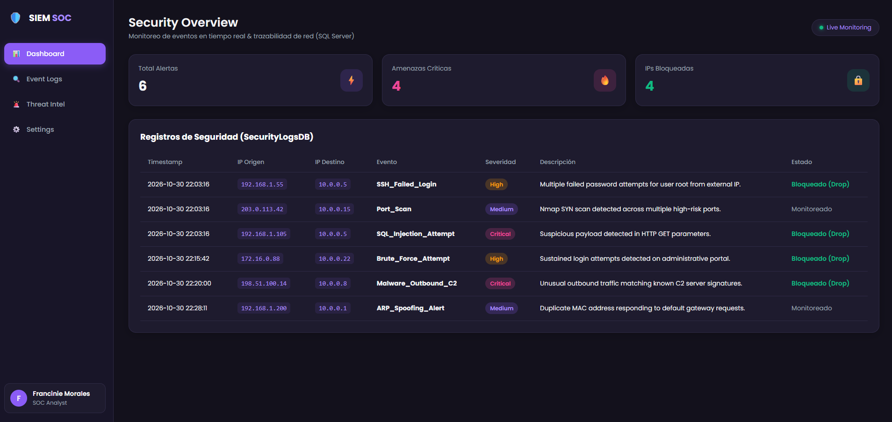
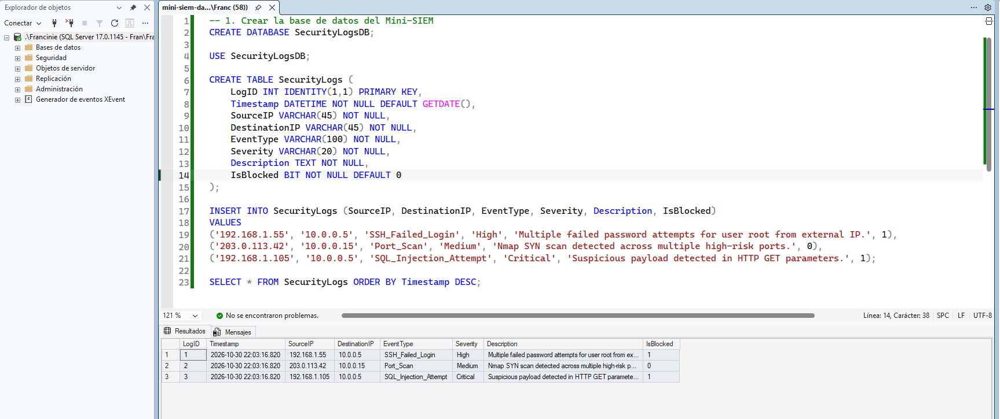

# Mini-SIEM Security Log Analyzer & SOC Operations Dashboard

Un panel interactivo de monitoreo de seguridad en tiempo real diseñado para operaciones **SOC (Security Operations Center)**. El proyecto simula la ingesta, clasificación y mitigación de eventos de red a partir de un modelo relacional diseñado en **Microsoft SQL Server**, presentado a través de una interfaz web moderna en tema oscuro.

---

## Capturas del Proyecto

### 1. Panel de Monitoreo SOC (Interfaz Web)


### 2. Base de Datos Relacional (SQL Server Management Studio)


---

## Funcionalidades Clave

- **Métricas Operativas en Tiempo Real (KPIs):** Indicadores visuales de alertas totales, amenazas críticas e IPs bloqueadas por la infraestructura de red.
- **Triage y Clasificación de Severidad:** Identificación visual de eventos clasificados como `Critical`, `High` y `Medium`.
- **Filtros Dinámicos de Monitoreo:** Navegación interactiva por pestañas (`Dashboard`, `Event Logs`, `Threat Intel`) que permite aislar eventos de alto riesgo.
- **Auditoría de Eventos de Ciberseguridad:** Registros basados en tráfico simulado de herramientas como Wireshark y Nmap (Fuerza bruta SSH, Inyección SQL, C2 Malware, Spoofing ARP).

---

## Tecnologías Utilizadas

- **Frontend:** HTML5 Semántico, CSS3 (Variables CSS, Flexbox, Grid Layout), JavaScript Vanilla (ES6+ DOM Manipulation).
- **Base de Datos / Modelo Relacional:** Microsoft SQL Server (`SecurityLogsDB`), T-SQL.
- **Ciberseguridad / Redes:** Alineado a conceptos de la certificación **Cisco Certified Support Technician (CCST) Cybersecurity**.
- **Control de Versiones:** Git & GitHub.

---

## Estructura de la Base de Datos (SQL Server)

El proyecto incluye el archivo `schema.sql` con el modelo relacional utilizado para almacenar los datos de auditoría:

```sql
CREATE TABLE SecurityLogs (
    LogID INT IDENTITY(1,1) PRIMARY KEY,
    Timestamp DATETIME NOT NULL DEFAULT GETDATE(),
    SourceIP VARCHAR(45) NOT NULL,
    DestinationIP VARCHAR(45) NOT NULL,
    EventType VARCHAR(100) NOT NULL,
    Severity VARCHAR(20) NOT NULL,
    Description TEXT NOT NULL,
    IsBlocked BIT NOT NULL DEFAULT 0
);